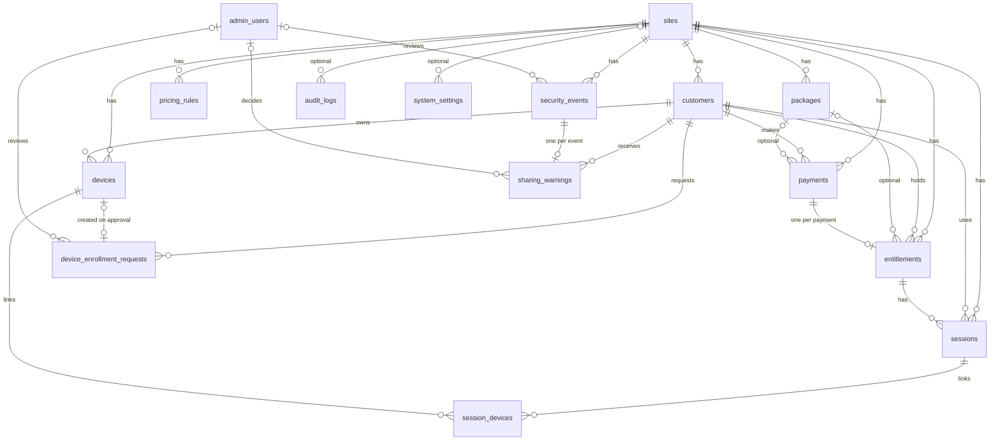

TASK 02 — Database Foundation

SMART Wi-Fi AutoPay (SPERACIO). Status of this document: describes the database
foundation as implemented in the repository files of TASK 02.

> **Verification status in one sentence:** the schema, migration and tests are
> written and statically checked, but **the migration has not yet been run against a
> real PostgreSQL database and no pytest run has been recorded.** See
> [Verification status](#12-known-limitations-and-verification-status).

## Contents

1. [Scope](#1-scope)
2. [Technology and configuration](#2-technology-and-configuration)
3. [Architecture](#3-architecture)
4. [Entity relationships](#4-entity-relationships)
5. [The 16 core tables](#5-the-16-core-tables)
6. [Migrations](#6-migrations)
7. [Preparing PostgreSQL](#7-preparing-postgresql)
8. [Health and readiness](#8-health-and-readiness)
9. [Testing](#9-testing)
10. [Security and data integrity](#10-security-and-data-integrity)
11. [Backup considerations](#11-backup-considerations)
12. [Known limitations and verification status](#12-known-limitations-and-verification-status)
13. [Decisions awaiting the project owner](#13-decisions-awaiting-the-project-owner)

---

## 1. Scope

TASK 02 establishes the database foundation only: schema, migration, connection
handling, a readiness check and schema tests.

**Out of scope (not implemented):** customer portal, admin dashboard, admin login,
customer registration, Mobile Money integration, payment callbacks, router/gateway
integration, captive portal, firewall rules, Internet access activation or
revocation, live session countdown, sharing-detection logic, notifications.

Business rules that need data from several tables (see section 12) are **not**
enforced by the database and are left to later backend tasks.

## 2. Technology and configuration

| Item | Value |
|---|---|
| Database | PostgreSQL, **13 or newer** (needs `gen_random_uuid()` and `EXECUTE FUNCTION` triggers) |
| Where it runs | A local gateway/server. The router itself is **not** assumed to host it. |
| ORM / SQL toolkit | SQLAlchemy 2.0.36 |
| Migrations | Alembic 1.14.0 |
| Driver | psycopg 3.2.3 (`psycopg[binary]`) |
| Existing stack (TASK 01) | Python, FastAPI, Uvicorn, pydantic-settings |

Dependencies are pinned in `backend/requirements.txt`. Test tools stay in
`backend/requirements-dev.txt`, which TASK 02 did not change.

### Connection settings

Read from environment variables or a private `backend/.env` file (never committed;
`.gitignore` excludes `.env*` except `.env.example`). The backend reads `.env` from
the directory it is started from, so **start it from `backend/`**.

| Variable | Default | Notes |
|---|---|---|
| `DB_HOST` | `127.0.0.1` | |
| `DB_PORT` | `5432` | 1–65535 |
| `DB_NAME` | `smart_wifi_autopay` | |
| `DB_USER` | `autopay_app` | |
| `DB_PASSWORD` | none | **No default.** Held as a `SecretStr`. Missing, empty or `CHANGE_ME` is refused. |

The connection is built from these separate values (not a text URL), so passwords
with special characters need no escaping and the password does not appear in a URL
or in logs.

## 3. Architecture

```
backend/
  alembic.ini                         Alembic settings (no connection string inside)
  migrations/
    env.py                            builds the connection from application settings
    script.py.mako                    template for new migration files
    versions/0001_initial_schema.py   creates the 16 tables
  app/
    core/config.py                    validated settings (DB_* variables)
    db/
      base.py                         Base, naming convention, mixins, MONEY type
      session.py                      engine, session scope, availability check
    models/                           one module per table (16) + __init__.py
    api/health_routes.py              GET /health and GET /health/ready
  tests/
    test_health.py                    TASK 01 health tests
    test_database_schema.py           metadata/schema tests
```

### Model architecture (`app/db/base.py`)

- **`Base`** is the declarative base. Importing `app.models` registers all 16 tables
  on `Base.metadata`.
- **Naming convention** (explicit, so migrations can drop or alter constraints
  reliably):

  | Kind | Pattern |
  |---|---|
  | Primary key | `pk_<table>` |
  | Foreign key | `fk_<table>_<column>_<referred table>` |
  | Unique constraint | `uq_<table>_<columns>` |
  | Check constraint | `ck_<table>_<name>` |
  | Index | `ix_<column label>`; explicit index names start with `ix_` or `uq_` |

- **Mixins:** `UUIDPrimaryKeyMixin` (UUID `id`, default `gen_random_uuid()`),
  `CreatedAtMixin`, `TimestampMixin` (`created_at`, `updated_at`).
- **`MONEY`** is `NUMERIC(12, 2)` (exact decimal, never float).
- **UUID primary keys** on every table.
- **UTC timestamps:** all `DateTime` columns are `TIMESTAMP WITH TIME ZONE`; creation
  and update times are set by the database (`now()`); the connection sets the session
  time zone to UTC.
- **Statuses** are stored as short text guarded by CHECK constraints (not native
  PostgreSQL enum types), which are simpler to change in a later migration.
- **JSONB** is used for `payments.pricing_snapshot` and `audit_logs.safe_metadata`.
- The model for the `sessions` table is class `Session`; it is unrelated to
  `sqlalchemy.orm.Session`. Import it from `app.models`.

### Foreign-key deletion policy

Every foreign key is **`ON DELETE RESTRICT`**. Payment, entitlement, session,
security and audit history cannot be orphaned by deleting a parent row. Customers,
devices, packages and rules are deactivated (status change), not deleted. The one
exception to "has a foreign key" is by design: `audit_logs.actor_id` and
`audit_logs.affected_record_id` have **no** foreign key, so audit history outlives
any account or record.

### Migration architecture

`0001_initial_schema.py` is **hand-written** (not autogenerated) so every table,
constraint and index can be reviewed. It uses explicit constraint names matching the
naming convention. It runs in **one transaction** (PostgreSQL supports transactional
DDL), so a failure leaves no half-built schema. `migrations/env.py` builds the engine
through the same code the backend uses, so the password comes only from `.env`.
Offline mode (`--sql`) is deliberately disabled.

### Database session management (`app/db/session.py`)

- `build_database_url()` creates a structured URL for `postgresql+psycopg` and
  refuses a missing or placeholder password (`DatabaseConfigurationError`).
- `create_db_engine()` creates a pooled engine (pool size 5, overflow 5, recycle
  1800 s, `pool_pre_ping`, 5 s connect timeout, UTC session time zone,
  `application_name=smart-wifi-autopay`). Creating an engine opens no connection.
- `session_scope(engine)` is a unit of work: **commit on success, roll back on any
  error**.
- `check_database(engine)` runs `SELECT 1` and returns true/false, logging only the
  error class (driver messages can contain connection details).

## 4. Entity relationships



`health_events` has no relationships by design (it must be writable even when other
data is unavailable). Some links are shown simplified (for example
`security_events` also has optional `customer_id` and `device_id`).

## 5. The 16 core tables

Common to all tables except where noted: UUID `id` primary key. "Timestamps" means
`created_at` and `updated_at` (UTC, database-set). Statuses are text with a CHECK.

### 5.1 `sites`
Purpose: one Wi-Fi installation / customer location; almost everything references it,
so several locations can be supported later without redesign.
Fields: `name` (unique, not blank), `status` (`ACTIVE`/`INACTIVE`, default `ACTIVE`),
`timezone` (default `Africa/Dar_es_Salaam`, not blank), timestamps.
The database cannot verify that `timezone` is a valid IANA name; the backend must.

### 5.2 `admin_users`
Purpose: administrator accounts (global, not tied to one site).
Fields: `username` (unique, lowercase, at least 3 characters), `password_hash`
(at least 20 characters; never a plaintext password), `status`
(`ACTIVE`/`DISABLED`), `last_login_at` (optional), timestamps.

### 5.3 `customers`
Purpose: Wi-Fi customers of one site.
Fields: `site_id`, `customer_reference` (unique per site, not blank), `phone_number`
(optional; international format `+` followed by 8–15 digits), `status`
(`ACTIVE`/`SUSPENDED`/`INACTIVE`, default `ACTIVE`), timestamps.
Uniqueness: `(site_id, customer_reference)`; `(site_id, phone_number)` only when a
phone number exists (partial unique index). Index `(site_id, status)`.

### 5.4 `packages`
Purpose: administrator-created Internet packages. No prices are hard-coded.
Fields: `site_id`, `name` (unique per site), `description` (optional), `price`
`NUMERIC(12,2)` > 0, `duration_minutes` > 0, `device_limit` ≥ 1 (default 1),
`status` (`ACTIVE`/`INACTIVE`, default `ACTIVE`), timestamps.
Packages are deactivated, never deleted. Index `(site_id, status)`.

### 5.5 `pricing_rules`
Purpose: administrator-controlled custom customer-entered amounts. The backend alone
will calculate duration from the active rule.
Fields: `site_id`, `status` (`ACTIVE`/`INACTIVE`, default `INACTIVE`), `min_amount`,
`max_amount` (≥ min), `price_per_hour` (all `NUMERIC(12,2)` > 0),
`duration_policy` (`PROPORTIONAL` only), `rounding_policy`
(`DOWN`/`NEAREST`/`UP`, default `DOWN`), `rounding_step_minutes` ≥ 1 (default 1),
`min_duration_minutes` > 0, `max_duration_minutes` ≥ min, `device_limit` ≥ 1
(default 1), timestamps.
Constraint: a partial unique index allows **at most one `ACTIVE` rule per site**.

### 5.6 `devices`
Purpose: devices registered to customers. A MAC address is stored only as the
identifier reported by the gateway; it is **not** treated as proof of identity.
Fields: `site_id`, `customer_id`, `mac_address` (lowercase, colon-separated),
`hostname` and `user_agent` (optional, untrusted hints), `status`
(`PENDING`/`ACTIVE`/`REVOKED`/`BLOCKED`, default `PENDING`), `registered_at`,
`last_seen_at` (optional), timestamps.
Constraint: partial unique index `(site_id, mac_address)` for non-`REVOKED` devices.
Devices are revoked, never deleted.

### 5.7 `device_enrollment_requests`
Purpose: requests to add an additional device, with the administrator decision.
Fields: `site_id`, `customer_id`, `requested_mac_address`, `requested_hostname`,
`requested_user_agent`, `status` (`PENDING`/`APPROVED`/`REJECTED`/`CANCELLED`),
`requested_at`, `reviewed_at`, `reviewed_by` (→ `admin_users`), `decision_reason`,
`device_id` (→ `devices`, set on approval), timestamps.
Constraints: approved/rejected requests must have reviewer and review time; pending
requests have neither; `device_id` only when `APPROVED`; no two `PENDING` requests for
the same customer and MAC address (partial unique index).

### 5.8 `payments`
Purpose: payment transactions. Security-sensitive.
Fields: `site_id`, `customer_id`, `package_id` (optional), `amount` (expected) and
`verified_amount` (optional) both `NUMERIC(12,2)` > 0, `currency` (three uppercase
letters, default `TZS`), `provider` (lowercase, not blank), `provider_reference`
(optional), `internal_reference` (unique), `status` (`CREATED`, `PENDING`,
`CONFIRMED`, `FAILED`, `CANCELLED`, `EXPIRED`, `DUPLICATE`, `REVERSED`; default
`CREATED`), `verified_at`, `pricing_snapshot` (JSONB object, required), timestamps.
Constraints:
- `internal_reference` is unique.
- One provider reference per provider, ignoring rows marked `DUPLICATE` (partial
  unique index), so repeats can be recorded without breaking the rule.
- A `CONFIRMED` or `REVERSED` payment must have a provider reference, a verification
  time and a `verified_amount` **equal to** `amount`.
- `verified_at` may only be set for `CONFIRMED`/`REVERSED`.
No provider credentials or payer secrets are stored. No payment provider is assumed.

### 5.9 `entitlements`
Purpose: the customer's purchased right to use the Internet. Stored in the database,
so it does not depend on a browser timer.
Fields: `site_id`, `customer_id`, `payment_id` (**unique**: one entitlement per
payment), `package_id` (optional), `granted_amount` `NUMERIC(12,2)` > 0,
`granted_duration_minutes` > 0, `device_limit` ≥ 1, `valid_from`, `expires_at`
(must be later than `valid_from`), `status`
(`ACTIVE`/`SUSPENDED`/`EXPIRED`/`REVOKED`, default `ACTIVE`), timestamps.
The amount, duration and device limit are a **copy** of what was purchased; later
package edits do not change an existing entitlement.

### 5.10 `sessions`
Purpose: actual Internet access sessions created from an entitlement.
Fields: `site_id`, `customer_id`, `entitlement_id`, `gateway_reference` (optional, not
blank when set), `status` (`PENDING`/`ACTIVE`/`SUSPENDED`/`EXPIRED`/`REVOKED`,
default `PENDING`), `started_at`, `expires_at`, `revoked_at`, timestamps.
Constraints: start and expiry required once a session leaves `PENDING`; expiry after
start; `revoked_at` set if and only if status is `REVOKED`; at most **one live
session** (`PENDING`/`ACTIVE`/`SUSPENDED`) per entitlement (partial unique index).
Start and expiry are stored, so a restart does not reset the remaining time.

### 5.11 `session_devices`
Purpose: devices linked to a session, with history.
Fields: `session_id`, `device_id`, `status` (`ACTIVE`/`DISCONNECTED`/`REVOKED`, default
`ACTIVE`), `connected_at` (default now), `disconnected_at`, timestamps.
Constraints: `disconnected_at` is null exactly when status is `ACTIVE`, and never
earlier than `connected_at`; one `ACTIVE` link per device per session; a device is
`ACTIVE` in only one session at a time (two partial unique indexes).
The **device limit is not enforced here** (see section 12).

### 5.12 `security_events`
Purpose: security incidents. Weak signals never count as confirmed sharing.
Fields: `site_id`, `customer_id` and `device_id` (both optional), `event_type`
(lowercase snake_case), `evidence_description` (not blank), `confidence`
(optional `LOW`/`MEDIUM`/`HIGH`; strength of the signal only), `occurred_at`,
`review_status` (`PENDING_REVIEW`/`CONFIRMED`/`DISMISSED`, default `PENDING_REVIEW`),
`reviewed_at`, `reviewed_by` (→ `admin_users`), timestamps.
Constraint: pending events have no reviewer; `CONFIRMED`/`DISMISSED` events require
reviewer and review time.

### 5.13 `sharing_warnings`
Purpose: the two-warning policy for confirmed unauthorized sharing.
Fields: `customer_id`, `security_event_id` (**unique**), `warning_number` (1 or 2,
unique per customer), `status` (`ISSUED`, `SUSPENSION_PENDING_REVIEW`,
`SUSPENSION_RELEASED`, `SUSPENSION_MAINTAINED`), `warned_at`, `decided_by`
(→ `admin_users`), `decision_reason`, `reviewed_at`, timestamps.
Constraints: warning 1 can only be `ISSUED`; warning 2 can only be one of the three
suspension statuses; a release/maintain decision requires administrator, review time
and a non-blank reason.

### 5.14 `audit_logs`
Purpose: important administrator, system and customer actions. **Append-only.**
Fields: `site_id` (optional), `actor_type` (`ADMIN`/`SYSTEM`/`CUSTOMER`), `actor_id`
(null exactly when `SYSTEM`; no foreign key), `action` (lowercase, e.g.
`payment.confirmed`), `affected_record_type` and `affected_record_id` (both or
neither; no foreign key), `occurred_at`, `safe_metadata` (JSONB object, default `{}`).
No `created_at`/`updated_at`. Protections: see section 10.

### 5.15 `system_settings`
Purpose: controlled configuration, global (`site_id` empty) or per site.
Fields: `site_id` (optional), `setting_key` (lowercase, format-checked),
`setting_value` (text), `data_type` (`STRING`/`INTEGER`/`DECIMAL`/`BOOLEAN`, default
`STRING`), timestamps.
Constraints: key unique per site and unique among global settings (two partial unique
indexes); keys that look like secrets are rejected; `INTEGER`, `DECIMAL` and `BOOLEAN`
values must be well formed. **Secrets must not be stored here.**

### 5.16 `health_events`
Purpose: local system health events (not ISP Internet availability). Append-only by
design.
Fields: `component` (lowercase), `event_type` (lowercase), `status`
(`OK`/`DEGRADED`/`DOWN`), `description` (not blank, at most 1000 characters, rejects
`password=`-style text), `occurred_at`. No foreign keys and no `created_at`/`updated_at`.
No retention policy exists yet.

## 6. Migrations

Run every command from `backend/`, with PostgreSQL running and a private `.env`
containing a real `DB_PASSWORD`.

| Purpose | Command |
|---|---|
| Show migration history | `python -m alembic history` |
| Show the current revision of the database | `python -m alembic current` |
| Apply all migrations | `python -m alembic upgrade head` |
| Roll back one step | `python -m alembic downgrade -1` |
| Roll back everything | `python -m alembic downgrade base` |

- Applying `upgrade head` twice is safe: the second run does nothing (Alembic records
  the revision).
- A failed migration is rolled back as a whole (single transaction).
- A missing or placeholder `DB_PASSWORD` stops the migration with a clear message.
- `--sql` (offline) mode is disabled on purpose.

> **WARNING — destructive.** `downgrade()` of `0001` drops all 16 tables and **all
> their data**. Use `downgrade` **only in a disposable test database**. Never run it on
> a customer or production database without a verified backup.

## 7. Preparing PostgreSQL

These steps are **not part of the repository code and have not been executed by the
author**; adapt them to the target machine. Run as a PostgreSQL superuser, and choose
your own strong password (never commit it):

```sql
CREATE ROLE autopay_app LOGIN PASSWORD '<choose-a-strong-password>';
CREATE DATABASE smart_wifi_autopay OWNER autopay_app;
```

Put the same password in `backend/.env` as `DB_PASSWORD`. The owner role needs enough
privilege to create tables, indexes, a function and triggers in its own database
(true for the database owner).

## 8. Health and readiness

| Endpoint | Meaning | Responses |
|---|---|---|
| `GET /health` | Liveness: the backend process runs. Does not check the database. | `200` |
| `GET /health/ready` | Readiness: application running **and** the database answers a query. | `200` ready; `503` when the database is unavailable or not configured |

The readiness body reports `checks.application` (`ok`) and `checks.database`
(`ok`/`unavailable`). It never returns connection strings, credentials, driver error
messages, file paths or stack traces. The engine is created at startup and stored on
`app.state.db_engine`. The backend **always starts**, even when the database is down or
`DB_PASSWORD` is missing; the cause is logged (the problem only, never a secret).

## 9. Testing

Run from `backend/` with `python -m pytest -v` (use `python -m pytest` so the `app`
package is importable).

| Group | Files | Status |
|---|---|---|
| Health (liveness) | `tests/test_health.py` | Exists. **No execution re
